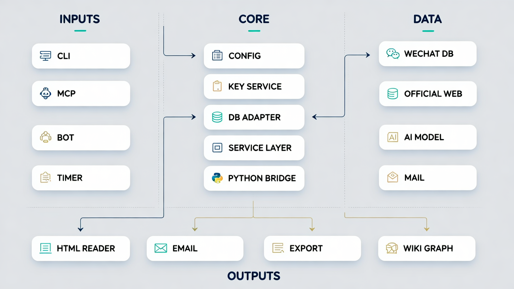

<div align="center">

<h1>𝗪𝗲𝗙𝗹𝗼𝘄 𝗖𝗟𝗜 </h1>

[简体中文](./README.md) · **English**

*"People today have never seen the moon of ancient times, yet today's moon once shone upon the people of old." — Li Bai*

> *"Heaven and earth are the inn of all things; time, a passing traveler through a hundred generations." — Li Bai*

> Bring your chat history, official-account reading, and personal knowledge workflows back to your own computer.

[](https://www.npmjs.com/package/weflow-cli)
[](https://nodejs.org/)
[](https://www.python.org/)
[](https://github.com/zhuobichen/weflow-cli/releases)
[](./SECURITY.md)
[](./LICENSE)

</div>

**WeFlow CLI turns WeChat into your local second brain**: read and query chat history locally with one command, export readable HTML; turn official-account articles into AI-digested daily reports (optionally mailed to you); read your WeChat favorites; build a semantic-searchable knowledge base — voice messages included — and plug it all into MCP-compatible AI editors like Claude Code. Works on Windows and Linux.

It is built to answer **questions WeChat itself cannot**: who is waiting on a reply, what I promised someone and whether I followed through, which relationships are cooling, how an account's position shifted over time, and what we were talking about on this day in earlier years.

> 🔒 **Local-first**: runs entirely on your machine — zero telemetry, zero cloud reporting. Database keys are stored locally, encrypted with machine-bound AES-256-GCM. AI features only activate after you explicitly configure your own API key. See the [Security & Privacy statement](./SECURITY.md).

> This project is intended only for data you are authorized to access. Please obey applicable laws, WeChat's terms, and the privacy of others.

> **⚠️ Use boundaries and risks**: Use this project only on devices you control and only with data you own or are explicitly authorized to access. Do not use it to monitor, track, or read another person's WeChat data, deploy it on someone else's device, or run it remotely and silently. Review applicable laws, WeChat's terms, and account permissions before use; third-party tools may trigger account restrictions or suspension. This is not legal advice, and users are responsible for their use of the project.

## At a Glance

**WeChat favorites query** (read local `favorite.db`, with type filter and keyword search):

```text
$ weflow-cli fav list -n 3

收藏列表 (共 1042 条, 显示 3 条):

[2026/8/21 19:42:42] [文章] “豆包型人格”爆火，可千万别学
    来源: 中国研究生
    https://mp.weixin.qq.com/s/eDk_kcyd8ltuqn6J3iReVg
[2026/8/21 10:50:38] [文章] 爆火插件让DeepSeek V4 Pro 0813性能拉满，全面超越 Fable 5！
    来源: 智猩猩AI
    https://mp.weixin.qq.com/s/3GXFjmtUsq42sXJHJGgwyg
[2026/8/21 10:47:21] [文章] 250年前，一个26岁年轻人写了一本小册子，至今仍在拷问每一个文明社会
    来源: 悦读撷英
    https://mp.weixin.qq.com/s/YIkB8TyyyimPP1hmgQQPZg
```

**The full workflow, one command per step**:

```text
weflow-cli sessions                    # list chat sessions
weflow-cli messages "contact" -n 20    # query chat messages
weflow-cli export "contact" html       # export HTML / Excel / TXT / JSON
weflow-cli fav list -t article -k AI   # favorites: type filter + keyword search
weflow-cli daily --date 2026-08-21     # official-account digest + AI summary
weflow-cli daily-server                # local reader http://localhost:8765
weflow-cli chat "How does RAG work?"   # knowledge-base RAG Q&A
weflow-cli mcp-config                  # one-shot MCP client integration
```

**Questions WeChat cannot answer** (all read-only, no network, no model calls):

```text
weflow-cli awaiting                    # who is waiting on a reply
weflow-cli bonds                       # relationship temperature: cooling, warming, WeChat-only
weflow-cli promises --days 180         # what I said I'd do, with the original words and follow-up evidence
weflow-cli today --years 1,3,5         # what we were talking about on this day in earlier years
weflow-cli network --with "contact"    # shared groups; --intro finds who could introduce you
weflow-cli timeline --source "account" # one account's articles laid out in time
```

## Direct Answers

**How do I export WeChat chats to HTML or Excel?**

```bash
weflow-cli export "Contact A" html      # also markdown / json / txt / excel
```

Output goes to `~/.weflow-cli/output/`; nothing is written back into the WeChat
directory. The HTML export embeds cached images and stickers.

**Can WeFlow read WeChat 4.x databases?**

Yes. WeChat 4.x uses SQLCipher and derives its keys at login:

```bash
weflow-cli init        # Windows / macOS: discover and derive
weflow-cli sessions    # if sessions list real chats, it worked
```

On Linux, add one login authorization first (`weflow-cli capture-passphrase`).
If automatic extraction fails anywhere, you can always supply the shared passphrase
yourself: `weflow-cli init --passphrase <64-hex>`, or set `WEFLOW_PASSPHRASE`.
**Databases are opened read-only** — no `-wal` / `-shm` is written next to them.

**Can I turn official-account articles into a daily report with AI summaries?**

```bash
weflow-cli daily --date YYYY-MM-DD    # fetch -> classify -> summarize -> HTML reader
weflow-cli daily --no-ai              # fetch and index only, no model calls
```

Only the "AI" and "Academic" topics are sent for summarization; the rest are tagged.
Each report ends with what that run cost.

**Are my chats uploaded anywhere?**

Not automatically. Local processing is the default; only features you explicitly
enable make network calls (article fetching, WeRead sync, the cloud AI you configure,
the optional bot channel). The databases are never uploaded as a whole.

**Does it need root / administrator rights?**

No, for reading, querying, exporting and daily reports. Only capturing the passphrase
on Linux asks for `sudo` once (to attach to the WeChat process); `--no-sudo` disables it.

**Where do I start?**

```bash
weflow-cli check           # dependencies, paths, how many databases are readable
weflow-cli check --report  # redacted verdict you can paste to someone else
```

## Platform Support

| Capability | Windows | macOS | Linux |
| --- | --- | --- | --- |
| Data-directory discovery | ✅ | ✅ | ✅ |
| Local data initialization | ✅ auto-discover/verify | ❌ credentials must be supplied manually | ✅ automatic after a one-time login authorization |
| Chat history query (NT / local databases) | ✅ | ✅ | ✅ |
| WCDB data service (contact nicknames, etc.) | ✅ | ⚠️ needs the native library | ⚠️ needs the native library |
| Official-account digest / knowledge base / MCP | ✅ | ✅ | ✅ |

macOS: there is no automatic initialization today. If you already have local data access through official or otherwise authorized means, follow the help of `weflow-cli init --path` and `config` to finish setup.

### Linux Quick Start (native WeChat 4.x for Linux)

```bash
# 1. sqlcipher development libraries (needed to build sqlcipher3)
sudo apt install libsqlcipher-dev

# 2. Python dependencies
pip3 install --user sqlcipher3 cryptography html2text zstandard

# 3. Install the CLI and initialize
npm install -g weflow-cli
weflow-cli capture-passphrase   # sign out and back in once in WeChat when prompted
weflow-cli init                 # derive per-database keys and write the config
```

`capture-passphrase` waits for that one re-login, then checks whether what it captured can actually open the databases (a page-level check per database) and only writes it when the check passes. One authorization is enough; you do not repeat it every run.

Availability on Linux still depends on the WeChat distribution, the Python dependencies, and your user's permissions. See [docs/LINUX.en.md](./docs/LINUX.en.md) for the question-and-answer version (export, database access, root, outputs). Run `weflow-cli check` first and configure within your system's security policy; do not lower machine-wide permissions just to troubleshoot.

## What You Can Do

| Scenario | Capability |
| --- | --- |
| Chat history | Query sessions, contacts, and messages; export to JSON, TXT, HTML, Excel. An HTML export also writes a media coverage report saying which images and stickers could not be embedded, and why. |
| Official-account digest | Crawl articles, AI summarization and classification, generate a local reading page, keep favorites and read states. |
| Personal knowledge base | Sync WeRead notes, build an Obsidian vault, semantic search, RAG Q&A, a concept wiki, and a **self-contained graph page** you can open by double-clicking (`weflow-cli wiki graph --open` for 3D, `--flat` for 2D - no server, no network; `--min-degree N` keeps only the hubs, `--line wiki\|chat` draws one corpus). |
| AI collaboration | Expose article crawling, knowledge-base retrieval, digests, and selected local-data tools to MCP-compatible clients. The inventory follows the current code and `docs/MCP.md`. |
| Personal review | Monthly chat reports, annual reports, todo extraction, and local Moments cache queries. |
| WeChat favorites | Read WeChat "Favorites" (official-account articles, text, images, videos, chat records) with type filters, keyword search, and Markdown/JSON export. |
| Second-brain agent | Chat with a local AI assistant inside WeChat: natural-language queries over chats, favorites, Moments, digests, WeRead, todos, and the knowledge base; three-tier memory across sessions, daemonized background service. It can also **fetch an official-account article**, search public articles, format Markdown for the WeChat editor, list contacts, read your learning reviews, health-check the knowledge base and skill packages, and mark a todo done (**never delete one**). What it can reach, and what stays out of reach, is in `docs/PROJECT_STATE.md` and `docs/DECISIONS.md` (D-058). |
| On-device panel | A floating ball on your desktop: click to chat with **the same brain as the WeChat side** (same memory, same quota), and each reply expands into a **thinking process** - what tool it called, how many round trips, why it stopped. The ball itself is transparent with a face per state, and a **Memory** button lists what it has stored about you long-term - each fact with the time it was written and the quote it came from (read-only). |
| Skill packages | The assistant reads the `SKILL.md` packages already on your machine (by default `~/.claude/skills` and `~/.weflow-cli/skills`): the prompt lists what exists, and a body is read on demand before following it. **A skill grants the assistant no new tools** - it is material: not executed, not installed, and unable to read configuration or databases. `weflow-cli skill check` reports unreadable frontmatter, cross-directory collisions, and non-conforming ids. |
| Conversation scenes | Give one conversation a fixed way of working: keywords plus an extra instruction, an output spec, and required skills. Each message picks one by **binding → keyword → last used**, and picks none when nothing matches, leaving the previous behaviour untouched. Manage with `weflow-cli scene`, or bind from the conversation with `场景 <id>`. **Scenes are not readable or writable by the model**, and which scene applied is recorded in the thinking process. |

> **⚠️ Intended use**: this tool only accesses data of **your own** WeChat account, on your own machine, with your own consent. Do not use it to monitor a partner, employee, or any third party without explicit consent, deploy it onto someone else's device, or run it remotely and silently. Review WeChat's terms, account-risk policies, and local legal requirements. See [SECURITY.md](SECURITY.md).

## Quick Start in Three Minutes

### 1. Install and Check

> npm packages and GitHub releases are published separately; if you need the newest fixes, check the npm package version first, or use the GitHub `master` branch directly.

Requires Node.js 22.13+, Python 3.10+, and a signed-in Windows WeChat. After installation, check your environment first:

```powershell
npm install -g weflow-cli
weflow-cli check
```

Install the Python dependencies required by the standard Windows 4.x workflow:

```powershell
python -m pip install -r requirements.txt
```

If you are still on WeChat 3.x, also install the optional dependencies: `python -m pip install -r requirements-3x.txt`.

### 2. Initialize Local Data Access

Close WeChat and run the initialization. Follow the prompts to start and sign in to WeChat; the CLI will try to discover the data directory and extract the required keys:

```powershell
weflow-cli init
```

The WeChat "storage location", account directory, and its `db_storage` directory can all be specified directly:

```powershell
weflow-cli init --path "D:\WeChat\xwechat_files"
```

Once initialization finishes, verify that your own data is readable:

```powershell
weflow-cli sessions
weflow-cli contacts -k "keyword"
weflow-cli messages "contact" -n 10
```

For key, database, or Python environment issues, follow the [Operations & Troubleshooting Guide](./OPERATIONS.md) step by step.

### 3. Pick a Workflow

**Export a chat history**

```powershell
weflow-cli export "contact" html --output ./output
```

HTML export embeds WeChat's cached thumbnails by default and reconstructs images, custom stickers, system messages, and article cards as far as the local data allows. Remote media is cached per URL under `.cover-cache/` in the output directory, so **a re-export is near-instant** (about 2s for 1600+ messages) and only the first export pays the network cost. Custom stickers decrypt offline from the local cache; when no sticker seed is configured the exporter derives it from WeChat's process memory and prints the command to persist it. Add `--full-images` for originals (5-24MB each) at several times the cost. See the [operations manual](./OPERATIONS.md#4-导出聊天记录) for details.

**Generate the official-account digest for a day**

```powershell
weflow-cli daily --date 2026-08-12 --api-key "Your DeepSeek API Key"
weflow-cli daily-server --date 2026-08-12

# Preview articles only; no AI calls or daily-report writes
weflow-cli daily --date 2026-08-12 --dry-run

# Generate without any AI calls; fetching, HTML, and local indexes remain enabled
weflow-cli daily --date 2026-08-12 --no-ai

# Push and digest-processing frequency per official account over the last 30 days
weflow-cli daily-stats --days 30 --limit 30

# Only include the given official accounts (repeatable, or comma-separated)
weflow-cli daily --source "AccountA" --source "AccountB"
weflow-cli daily --source "AccountA,AccountB"

# Persist digest sources; leave empty to restore "all accounts"
weflow-cli config set dailySources "AccountA,AccountB"

# Persist AI off for digests; set it back to true to re-enable
weflow-cli config set dailyAiEnabled false
weflow-cli config set dailyAiEnabled true

# Topics kept out of the digest (a display-layer switch: they are still fetched and
# archived, just not shown, so changing your mind needs no re-crawl). Focus topics
# cannot be excluded, and unknown topic names are ignored with a WARN.
weflow-cli config set dailyExcludeTopics "news,investing,academic"

# Pin a category for a source; a categorized source gets a summary only, and its tags
# come from the category you set rather than from the article.
weflow-cli config set dailySourceCategories '<JSON: source name or gh_ ID -> category>'

# Optional: decide article topic and relevance with TypeSafe's Jev decision model
# instead of parsing it out of generated text. Without the key the previous
# LLM-parse path is used unchanged.
weflow-cli config set typesafeApiKey "..."
```

The reader serves at `http://localhost:8765/` by default.

**Use the versioned message contract**

```powershell
weflow-cli export "contact" json --contract weflow-v1 --output ./output
```

The generated envelope keeps message fields stable and includes conservative `coverage` metadata. For incremental reads, use an overlapping `--from` time window and deduplicate locally by conversation plus `localId`/`serverId`, or let `sync` keep the checkpoint and report what it covered. A stable cursor is still not exposed: it has to be backed by every database backend before it can be advertised. The legacy JSON export remains a top-level array.

**Connect an AI editor**

```powershell
weflow-cli mcp-config > .mcp.json
```

Place the generated configuration wherever your MCP client expects it and restart the client. See `weflow-cli mcp-config` output for the tool list and configuration details.

Beyond the knowledge-base tools, the MCP server also exposes selected local WeChat data capabilities (sessions, chat history, favorites, Moments, digests, WeRead, todos, knowledge base, and assistant memory). By default MCP sends no messages, publishes no articles, and modifies no todos, memory, or configuration. See the [MCP Integration Guide](./docs/MCP.md) for the current inventory and security boundaries.

**Host a local AI assistant in WeChat (second brain)**

```powershell
weflow-cli config set deepseekApiKey "sk-..."   # or any OpenAI-compatible endpoint: aiBaseUrl + aiModel
weflow-cli login-wechat        # scan the QR code to bind the messaging channel (a ClawBot contact appears in WeChat)
weflow-cli assistant start     # run the agent as a background daemon
weflow-cli panel               # open the on-device panel window (usable without scanning a QR code)
```

`weflow-cli panel` opens a small always-on window that talks to **the same brain as the WeChat side** — the same memory, the same daily quota. **No WeChat login is required**: the messaging channel is optional. The window is only a client; its messages go to the daemon's entry point on `127.0.0.1`, so the two entry points never keep separate copies of memory.

The floating ball needs Electron (`npm i -g electron`); without it the panel degrades to an Edge/Chrome `--app` window — same UI, but no frameless always-on-top ball, no tray, no global shortcut. With the ball (a 96px mascot): **click it and the chat bubble opens beside it (the ball itself stays put; click again to collapse)**. The bubble opens to the left of the ball by default, flips to the right when there is no room on the left, and top-aligns when vertical space runs short; drag the ball to move it, and the position is remembered. **The ball is transparent - only the mascot shows through** - calm at rest, and switching to a *thinking* face for the seconds you are waiting on an answer (offline and quota-exhausted have faces of their own). **Press and hold it and it is picked up by the scruff - a twelve-frame lift (six up, six back down) that settles on release** (skipped when the system asks for reduced motion). **Run the pointer across it and it squirms as if tickled** - four poses, with **no tilt** (the 4-degree rotation it
used to work out from how fast you move was removed on 2026-10-02, so that running the pointer across it no longer
looks like a small take-off: rotation belongs to the lift alone). **Carried around it swings left and right - the side you move towards swings further, and faster movement swings wider.** It **hops when a reply lands**, **blinks every 7-13 seconds**, its eyes follow the pointer, and dragged to a screen edge it hides half-way behind it.

**Every reply carries a collapsible "thinking process" (closed by default)**: how that turn actually went - the routing decision, which tool it called, its arguments, how many round trips, and why it stopped. It is the same record you get in WeChat by sending 轨迹 (or 思考过程), so the two cannot drift apart.

**Right-click anywhere in the panel** to draft a reply for someone on your list (`weflow-cli config set quickReplyContacts "Alice,Bob"` — a click sends that conversation to two cloud models and returns text only, never sending for you). The menu also carries a row of one-click actions (who is waiting on a reply, todos, digests, stats, reading stats, sessions, Moments, WeRead), and its last item tucks the ball away; the tray icon brings it back. Running a tool **never pops up a console window**, and the window recovers by itself after the assistant restarts - you do not have to reopen it.

Then just talk to ClawBot on your phone. The assistant queries local chats and favorites to answer, with memory that survives across sessions:

- "What have I been busy with lately?" — synthesizes recent sessions and messages
- "Summarize my chats with XX" — pulls that thread's history
- "Which AI articles do I have in favorites?" — searches WeChat favorites
- "What does this favorited article say?" — fetches and summarizes the article body
- "What's new on my Moments?" / "Who posts the most?" — Moments timeline and stats
- "What did official accounts push today? Any AI ones?" — digest queries with topic/keyword filters
- "What am I reading?" / "My notes on XX" — WeRead shelf and notebooks
- "Any pending todos? Anything urgent?" — todo list sorted by urgency
- "How does my knowledge base explain RAG?" — concept-wiki lookup
- "Draft a reply to Lao Wang" — first judges what the other side wants, the risk, and whether substance should be given, then offers a few candidates. **Text only, never sent for you**; when money or high risk is involved it withholds drafts and only says what to confirm first
- "Remember: my project is called weflow-cli" — writes to long-term memory

How it works: the daemon long-polls WeChat's official bot channel (iLink); the agent loop, three-tier memory (working window / rolling summary / long-term facts), and all database queries run on your machine. Only the final question and reply texts go to the configured LLM; the shipped default is `assistantPrivacy=strict`: phone numbers, emails, and links in tool output are redacted, and third-party chat bodies never leave the machine (`balanced` lets bodies out but still masks PII, `open` masks nothing; a local `ollama` engine keeps everything offline). Sessions expire after 24h of inactivity, and proactive replies per window are capped by official limits.

Cost guardrails: a built-in daily cap of 100 processed messages (send "记忆" in WeChat to check usage). The assistant denies all incoming users by default; configure an explicit whitelist before AI calls are enabled:

```powershell
weflow-cli config set assistantWhitelist "your-@im.wechat-ID"   # unset = deny everyone
```

Group chat currently depends on whether WeChat's official bot channel actually delivers explicit group events; this project never joins groups through client automation or unofficial protocols. Should upstream ever provide group IDs, sender IDs, and @-mention fields, group messages still default to deny — you must set the group whitelist, keep the member whitelist, and leave the @ requirement on:

```powershell
weflow-cli config set assistantGroupWhitelist "group-id"
weflow-cli config set assistantGroupRequireMention true
```

This only takes effect once the official channel really delivers group events; ClawBot direct messages are unaffected today.

Management: `weflow-cli assistant status` / `log` / `stop`; send "帮助" in WeChat for in-chat commands.

## Common Commands

| Goal | Command |
| --- | --- |
| Check environment & config | `weflow-cli check` · `weflow-cli config show` |
| Initialize or specify paths | `weflow-cli init [--path <dir>]` |
| Browse chat data | `weflow-cli sessions` · `weflow-cli messages <contact>` · `weflow-cli contacts` |
| Who is waiting on a reply | `weflow-cli awaiting --dry-run` · `weflow-cli awaiting --yes` |
| Draft a reply (text unless you pick and send) | `weflow-cli draft <contact> --dry-run` · `--yes` (**only** `--pick N --send --yes` actually sends; both flags are required) |
| Relationship temperature | `weflow-cli bonds` (who is cooling, who is warming, who only has WeChat; read-only, local, no model) |
| What I promised whom | `weflow-cli promises --days 180` (original words plus follow-up evidence; rule-based, no model) |
| This day in earlier years | `weflow-cli today --years 1,3,5` (what you were talking about back then) |
| People graph | `weflow-cli network --groups` · `--with <name>` (shared groups) · `--intro <name>` (who could introduce you; reads `contact.db` only) |
| One account over time | `weflow-cli timeline --list` · `--source <account>` (its articles laid out in time) |
| Local judgement primitive | `weflow-cli decide --request <file> --dry-run` · `--yes` |
| Export chat history | `weflow-cli export <contact> <json\|txt\|html\|excel>` |
| Sync checkpoint | `weflow-cli sync run <contact> --since <date>` · `sync status` · `sync verify` |
| Digest & reader | `weflow-cli daily` · `weflow-cli daily-server` · `weflow-cli review` |
| Moments cache | `weflow-cli sns timeline` · `weflow-cli sns users` · `weflow-cli sns stats` |
| WeChat favorites | `weflow-cli fav list` · `weflow-cli fav export markdown` · `weflow-cli fav set-key` |
| WeRead | `weflow-cli weread shelf` · `notes` · `search` · `stats` (get the key from https://weread.qq.com/r/weread-skills; see [OPERATIONS.md](./OPERATIONS.md)) |
| Knowledge base | `weflow-cli vault` · `weflow-cli wiki` · `weflow-cli search <query>` · `weflow-cli chat` (semantic search needs `config set dashscopeApiKey` first; `search --phrase <words> --line all` also matches voice transcripts) |
| Reports & tasks | `weflow-cli report` · `annual-report` · `todos` |
| Second-brain assistant | `weflow-cli assistant start` · `status` · `log` · `stop` |
| On-device panel | `weflow-cli panel` — floating window; `--status` reads state only, `--ask "…"` asks from the command line |
| AI editor integration | `weflow-cli mcp-config` |

Run `weflow-cli <command> --help` for the full options of any command. For example:

```powershell
weflow-cli export --help
weflow-cli daily --help
```

## Running from Source

```powershell
git clone https://github.com/zhuobichen/weflow-cli.git
cd weflow-cli
npm install
npm run build
npm run dev -- check
npm run dev -- init
```

Main Python workflows:

```powershell
# Article crawling -> AI classification -> HTML reading page -> Wiki / learning digest
python scripts/pipeline.py --date YYYY-MM-DD --api-key "Your API Key" --engine deepseek

# Note: this does **not** write your Obsidian Vault by default (no Sources/WeChat copy, no concept pages).
# Obsidian's own graph view is live - it watches the vault's files and re-renders when one changes.
# To make the graph follow the content, ask for it explicitly (either flag works alone too):
python scripts/pipeline.py --date YYYY-MM-DD --api-key "Your API Key" --with-vault --with-wiki

# Run step by step
python scripts/biz_daily.py --date YYYY-MM-DD --api-key "Your API Key"
python scripts/generate_html.py --date YYYY-MM-DD
python scripts/fav_server.py --date YYYY-MM-DD
```

## Architecture



The project is split into five clearly bounded parts:

| Directory | Responsibility |
| --- | --- |
| `bin/` | Commander CLI entry and interactive flows. |
| `src/core/` | WeChat data directory discovery, keys, NT/WCDB/SQLCipher database access. |
| `src/services/` | Chat, contacts, export, config, message channel, and other business capabilities. |
| `scripts/` | Python workflows: official-account digest, reader, knowledge pipelines, reports, search. |
| `mcp-server/` | stdio server for MCP clients. |

For a more complete view of modules and data flow, read [ARCHITECTURE.md](./ARCHITECTURE.md).

## Privacy & Security

- Databases, key configuration, and exported files stay on your machine by default; key fields are stored machine-bound and encrypted.
- Network requests involving DeepSeek, article crawling, WeRead, or MCP happen only when you run the corresponding workflow.
- Use `whitelist`, `blacklist`, and `audit` to manage or audit message sending; always confirm the target contact and content before sending.
- After upgrading WeChat, switching accounts, or migrating computers, you may need to re-initialize or re-scan NT keys.
- `init` validates existing local configuration first and does not re-capture keys when that validation passes. Use `weflow-cli init --refresh` only after a migration, an account switch, or an access failure.
- To test a first-time initialization or a failed key, prefer `weflow-cli init --test-missing-keys`; it simulates missing keys for that run only and leaves the saved configuration untouched. When keys really have failed, `weflow-cli config forget-keys` clears the database access keys only and asks for confirmation.
- **Voice transcription runs on your machine** (`faster-whisper`, local model); audio never leaves it, and transcripts are cached by content hash so an interrupted run resumes. It is **not guaranteed accurate** — dialect, accent and background noise all introduce errors; the purpose is "you can find what was said", not a verbatim record. Transcripts join the phrase index only, never the semantic index (no second embedding bill for dialect-approximate text).
- **Message shards are split by time** (`message_0..3.db`, roughly a year each), so "older chats" depend on whether the shard covering that period is still on the machine; `weflow-cli check --report` lists each shard's read status.
- Running `weflow-cli daily` without a date checks yesterday's artifacts first: if yesterday's `README.md`, article index, or `index.html` is missing, it backfills yesterday and only generates today once that succeeds. Passing `--date` or `--dry-run` skips the backfill.

## Documentation & Feedback

- [Operations & Troubleshooting Guide](./OPERATIONS.md): initialization, NT keys, environment issues, common errors.
- [Cross-machine Deployment Guide](./docs/SETUP.md): full installation on a new Windows PC.
- [MCP Integration Guide](./docs/MCP.md): client configuration, tool scopes, security boundaries.
- [Detailed Architecture](./ARCHITECTURE.md): modules, data flow, implementation boundaries.
- [Project State](./docs/PROJECT_STATE.md): current capabilities, constraints, priorities, and handoff entry point.
- [Technical Decisions](./docs/DECISIONS.md): durable design rationale for long-term maintenance.
- [Extending Guide](./docs/EXTENDING.md): what to touch to add a tool, config key, command, MCP tool, or Python script — and which test will stop you. **There is no plugin loader today**; this document says why, and how to extend anyway.
- [Branches & Merges](./docs/BRANCHES.md): branch purposes, merge timeline, and conventions for parallel work.
- [Release Checklist](./docs/RELEASING.md): version numbers, packaging checks for sensitive content, npm credentials, and mirror sync.
- [npm Publish FAQ](./docs/NPM-PUBLISH.md): whether 404 / 409 / ETARGET means failure or propagation — look it up by symptom.
- [Scheduled Health Check](./docs/HEALTH-CHECK.md): one command for version drift, missed shards, stale sessions, and failed exports.
- [Electronic Evidence Guide](./docs/EVIDENCE_GUIDE.md): preservation workflow, legal boundaries, and usage notes.
- [Contributing Guide](./CONTRIBUTING.md) and [Security Policy](./SECURITY.md): development, feedback, and sensitive issues.
- [Changelog](./CHANGELOG.md): release summaries.
- [GitHub Issues](https://github.com/zhuobichen/weflow-cli/issues): please attach sanitized command output, OS, WeChat version, and reproduction steps.

## Acknowledgments & License

This project draws on or uses fine projects such as [WeFlow](https://github.com/hicccc77/WeFlow), [koffi](https://koffi.dev/), [ExcelJS](https://github.com/exceljs/exceljs), and [Scrapling](https://github.com/D4Vinci/Scrapling).

Released under the [MIT License](./LICENSE).
