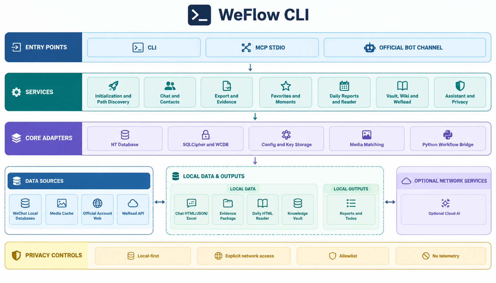

<div align="center">

<h1>𝗪𝗲𝗙𝗹𝗼𝘄 𝗖𝗟𝗜 </h1>

**简体中文** · [English](./README.en.md)

*今人不见古时月，今月曾经照古人*

> 夫天地者，万物之逆旅也；光阴者，百代之过客也。

> 让聊天记录、公众号阅读和个人知识工作流回到你的本地电脑。

[](https://www.npmjs.com/package/weflow-cli)
[](https://nodejs.org/)
[](https://www.python.org/)
[](https://github.com/zhuobichen/weflow-cli/releases)
[](./SECURITY.md)
[](./LICENSE)

</div>

**WeFlow CLI 把微信变成你的本地第二大脑**：在本机读取和查询聊天记录、导出可读 HTML；把公众号文章整理成带 AI 摘要的日报（可邮件推送）；读取微信收藏；构建可语义搜索的知识库（连语音消息也能搜）；并通过 MCP 接入 Claude Code 等 AI 编辑器。支持 Windows 与 Linux。

它专门回答**几个微信自己回答不了的问题**：谁在等我回话、我答应过谁什么后来做了没有、和谁的关系在变淡、某个号的观点怎么变的、那一年的今天我们在聊什么。

> **本地优先**：默认在本机处理数据，不内置遥测；明确选择的在线服务和云端 AI 会发起网络请求。配置密钥的加密、独立密钥缓存和可选明文数据库缓存具有不同的安全边界，详见[安全与隐私声明](./SECURITY.md)。

> 本项目仅限于处理你有权访问的数据。请遵守适用法律、微信规则和他人的隐私边界。

> **⚠️ 使用边界与风险**：仅在你本人控制的设备上，处理你本人拥有或明确获授权访问的数据。请勿将本项目用于监控、跟踪或读取他人的微信数据，也不要部署到他人设备或远程静默运行。使用前请自行确认适用法律、微信服务条款及账号权限；第三方工具可能触发账号风控、限制或封禁。本项目不构成法律意见，使用者需自行承担使用责任。

## 效果一览

**微信收藏查询**（读取本地 `favorite.db`，支持类型过滤与关键词搜索）：

```text
$ weflow-cli fav list -n 3

收藏列表 (共 1042 条, 显示 3 条):

[2026/8/21 19:42:42] [文章] “豆包型人格”爆火，可千万别学
    来源: 中国研究生
    https://mp.weixin.qq.com/s/eDk_kcyd8ltuqn6J3iReVg
[2026/8/21 10:50:38] [文章] 爆火插件让DeepSeek V4 Pro 0813性能拉满，全面超越 Fable 5！
    来源: 智猩猩AI
    https://mp.weixin.qq.com/s/3GXFjmtUsq42sXJHJGgwyg
[2026/8/21 10:47:21] [文章] 250年前，一个26岁年轻人写了一本小册子，至今仍在拷问每一个文明社会
    来源: 悦读撷英
    https://mp.weixin.qq.com/s/YIkB8TyyyimPP1hmgQQPZg
```

**完整工作流，一条命令一个环节**：

```text
weflow-cli sessions                    # 会话列表
weflow-cli messages "联系人" -n 20      # 查询聊天消息
weflow-cli export "联系人" html         # 导出 HTML / Excel / TXT / JSON
weflow-cli fav list -t article -k AI   # 微信收藏: 类型过滤 + 关键词搜索
weflow-cli daily --date 2026-08-21     # 公众号日报 + AI 摘要与分类
weflow-cli daily-server                # 本地阅读器 http://localhost:8765
weflow-cli chat "RAG 的原理是什么?"     # 知识库 RAG 问答
weflow-cli mcp-config                  # 一键接入 Claude Code 等 MCP 客户端
```

**几个微信给不出答案的问题**（都只读本地库，不联网、不调模型）：

```text
weflow-cli awaiting                    # 谁在等我回话
weflow-cli bonds                       # 关系温度：谁在冷却、谁只有微信这一条线
weflow-cli promises --days 180         # 我答应过谁什么，后来做了没有（带原话与后续证据）
weflow-cli today --years 1,3,5         # 那几年的今天，我们在聊什么
weflow-cli network --with "联系人A"     # 我和他共同在哪些群；--intro 看谁能引荐
weflow-cli timeline --source "某号"     # 这个号历次说法的时间线
```

## 平台支持

| 能力 | Windows | macOS | Linux |
| --- | --- | --- | --- |
| 数据目录自动发现 | ✅ | ✅ | ✅ |
| 本地数据初始化 | ✅ 自动发现/验证 | ❌ 需手动提供凭据 | ⚠️ 取决于发行版与权限 |
| 聊天记录查询（NT / 本地数据库） | ✅ | ✅ | ✅ |
| WCDB 数据服务（联系人昵称等） | ✅ | ⚠️ 依赖原生库 | ⚠️ 依赖原生库 |
| 公众号日报 / 知识库 / MCP | ✅ | ✅ | ✅ |

macOS：当前不提供自动初始化；如你已通过官方或其他经授权的方式取得本地数据访问凭据，请按 `weflow-cli init --path` 和 `config` 的帮助完成配置。

### Linux 快速上手（微信 4.x Linux 原生版）

```bash
# 1. 安装 sqlcipher 开发库（编译 sqlcipher3 需要）
sudo apt install libsqlcipher-dev

# 2. 安装 Python 依赖
pip3 install --user sqlcipher3 cryptography html2text zstandard

# 3. 安装 CLI 并初始化
npm install -g weflow-cli
weflow-cli init    # 按提示完成本地初始化
```

Linux 的自动初始化能力取决于微信发行版、Python 依赖和当前用户权限；请先运行 `weflow-cli check`，按系统安全策略配置，不要为了排障降低整机权限。

## 你可以做什么

| 场景 | 能力 |
| --- | --- |
| 聊天记录 | 查询会话、联系人和消息；导出 **Markdown / JSON / TXT / HTML / Excel**。Markdown 导出把图片**落盘**到 `<会话>_assets/`、正文用相对路径引用（喂给编辑器或别的工具时这才是能用的形态）；**文档本体**（微信里的 Word/Excel/PDF/PPT 等）按原名与扩展名拷进 `<会话>_assets/files/`，正文里按原名链接到 `files/` 下；HTML 导出内嵌图片并给出一份媒体覆盖报告（哪些没嵌上、为什么）。**匹配只做一遍**：Markdown 导出写下清单，之后 JSON/TXT/Excel 导出（或 `--media`）会自动带上同样的图片与文档路径。 |
| 公众号日报 | 抓取文章、AI 摘要与分类、生成本地阅读页，保留收藏和已读状态。 |
| 个人知识库 | 同步微信读书笔记、构建 Obsidian Vault、语义搜索、RAG 问答和概念 Wiki，以及**双击就能打开**的概念图谱页面（`weflow-cli wiki graph --open` 出 3D、加 `--flat` 出 2D；自包含、不联网、不需要服务器；`--min-degree N` 只看枢纽、`--line wiki\|chat` 只看一条线；**2D 页里点一条边能看到它凭什么连着**——两页的共同来源卡片，没有共同来源的边也会如实说来自正文链接）。 |
| AI 协作 | 通过 MCP 把文章、知识库、日报和受控的本地数据能力交给兼容客户端；工具清单以 `weflow-cli mcp-config` 和 `docs/MCP.md` 为准。 |
| 个人回顾 | 聊天月报、年度报告、待办提取与朋友圈本地缓存查询。 |
| 微信收藏 | 读取微信"收藏"内容（公众号文章、文字、图片、视频、聊天记录），支持类型过滤、关键词搜索与 Markdown/JSON 导出。 |
| 第二大脑 Agent | 在微信里和本地 AI 助手对话：自然语言查询聊天记录、收藏、朋友圈、日报、微信读书、待办与知识库；三层记忆跨会话延续，守护进程常驻后台。也能**抓一篇公众号正文**、在公开文章里搜、把 Markdown 排成公众号格式、列通讯录、读学习回顾、体检知识库与技能包、把待办标记完成（**不能删除**）。它调得到的工具与不可达的边界见 `docs/PROJECT_STATE.md` 与 `docs/DECISIONS.md`（D-058）。 |
| 本机面板 | 桌面常驻的悬浮球：点开即对话（与微信里**同一个大脑**、同一份记忆与配额），每条回答下面可展开**「思考过程」**（它调了什么工具、几轮、为什么停），球本身有状态表情、透明底，面板里还有一个**「记忆」**按钮：能看它对你长期记下了什么（每条带写入时间和来源原话，只读）。 |
| 技能包 | 助手能读你机器上已有的 `SKILL.md` 技能包（默认扫 `~/.claude/skills` 与 `~/.weflow-cli/skills`）：提示词里列出有哪些，要用时读正文再照着做。**技能不给助手增加任何工具**——它只是资料，不执行、不安装、读不到配置和数据库。`weflow-cli skill check` 报出读不出来、跨目录同名和 id 不合规的技能。 |
| 会话场景 | 给某个会话一套固定的做法：关键词 + 附加指令 + 输出规范 + 所需技能。消息进来按「绑定 → 关键词 → 上次用过的」挑一个，都没中就完全按原来的行为。用 `weflow-cli scene` 管理，或在对话里发「场景 <id>」绑定。**场景不让模型读写**，本次用了哪个场景会记在「思考过程」里。 |

> **⚠️ 合法使用边界**：本工具仅限访问**你自己拥有并登录的微信账号**在自己设备上的数据。未经他人明确同意，不得用它监控配偶、员工或任何第三方，也不得部署到他人设备或远程静默运行。请同时留意微信服务条款、账号风控和当地法律要求。详见 [SECURITY.md](SECURITY.md)。

## 三分钟上手

### 1. 安装与检查

> npm 包与 GitHub 发布分开进行；需要最新修复时，请先确认 npm 包版本，或直接使用 GitHub `master` 分支代码。

需要 Node.js 22.13+、Python 3.10+，以及已登录的 Windows 微信。安装后先检查本机环境：

```powershell
npm install -g weflow-cli
weflow-cli check
```

> Windows 上如果这条报 **「无法加载文件 …\npm\weflow-cli.ps1，未进行数字签名」**，拦住它的是
> PowerShell 的执行策略，不是包本身。两条路，任选：
>
> - 马上能用：换成 `weflow-cli.cmd check`（`.cmd` 那份包装不走 PowerShell 策略）；
> - 一次性解决：`Set-ExecutionPolicy -Scope CurrentUser RemoteSigned`，然后重开终端。

一条命令装好 Python 依赖（推荐）——它会在 `~/.weflow-cli/venv` 建一个本工具**自管**的虚拟环境
并安装依赖，之后的 Python 工作流会优先用它，不用再管 PATH 上哪个 Python 可用
（Windows 上自动改用 `sqlcipher3-wheels` 预编译轮，省去装编译器的麻烦）：

```powershell
weflow-cli setup
```

也可以手动安装（效果相同；从源码运行时在仓库根目录执行）：

```powershell
python -m pip install -r requirements.txt
```

若仍在使用微信 3.x，再安装可选依赖：`python -m pip install -r requirements-3x.txt`。

### 2. 初始化本地数据访问

关闭微信后运行初始化，按提示启动并登录微信，CLI 会尝试发现数据目录并提取所需密钥：

```powershell
weflow-cli init
```

> **数据目录不在默认位置时，请同时用 `--path` 指定。** 关掉微信之后，自动发现只剩下
> "`文档\xwechat_files` 这类默认位置"这一条路；微信"存储位置"改到别的盘的用户会直接看到
> 「未检测到微信数据目录」。

微信“存储位置”、账号目录和其 `db_storage` 目录都可以直接指定：

```powershell
weflow-cli init --path "D:\WeChat\xwechat_files"
```

初始化完成后，先验证是否能读取到自己的数据：

```powershell
weflow-cli sessions
weflow-cli contacts -k "关键词"
weflow-cli messages "联系人" -n 10
```

遇到密钥、数据库或 Python 环境问题，请按 [操作与排障手册](./OPERATIONS.md) 逐项检查。

### 3. 选择一条工作流

**导出一段聊天记录**

```powershell
weflow-cli export "联系人" html --output ./output
```

HTML 导出默认内嵌微信缓存里的缩略图，并尽力还原图片、表情包、系统消息和公众号卡片。远程媒体按 URL 缓存在输出目录的 `.cover-cache/`，所以**重复导出接近瞬时**（实测 1600+ 条约 2 秒），首次导出才需要联网。自定义表情包从本地缓存离线解密，seed 未配置时会自动扫描微信内存反推并提示固化命令。想改用**原图作为来源**时加 `--full-images`（原图常有 5–24MB/张，处理它们会慢数倍；**嵌入前仍按上限缩放**，所以导出物不会因此变大成几百 MB，实测两档体积相当）。细节见[操作与排障手册](./OPERATIONS.md#4-导出聊天记录)。

**生成当天公众号日报**

```powershell
weflow-cli daily --date 2026-08-12 --api-key "你的 DeepSeek API Key"
weflow-cli daily-server --date 2026-08-12

# 仅预览指定日期的文章，不调用 AI、不写入日报
weflow-cli daily --date 2026-08-12 --dry-run

# 单次生成日报时关闭所有 AI，仍保留抓取、HTML 和本地索引
weflow-cli daily --date 2026-08-12 --no-ai

# 查看最近 30 天各公众号的推送与日报处理频率
weflow-cli daily-stats --days 30 --limit 30

# 只生成指定公众号的日报（可重复，也可用逗号分隔）
weflow-cli daily --source "公众号A" --source "公众号B"
weflow-cli daily --source "公众号A,公众号B"

# 持久化日报来源；留空则恢复为全部公众号
weflow-cli config set dailySources "公众号A,公众号B"

# 持久化关闭日报 AI；恢复为 true 即重新启用
weflow-cli config set dailyAiEnabled false
weflow-cli config set dailyAiEnabled true

# 不在日报里出现的主题（展示层开关：照常抓取归档，只是不展示；改主意不用重抓）
# 焦点主题 AI 不能排除，写错的主题名会被忽略并打 WARN
weflow-cli config set dailyExcludeTopics "新闻,投资,学术"

# 为来源设置固定类别；已分类来源只生成摘要，主题用你配的、标签取该类别（不会有真标签）
weflow-cli config set dailySourceCategories '<JSON object: source name or gh_ ID -> AI/政治/学术/新闻/文学/投资>'

# 文章主题与相关度改由 Jev 决策模型判断（可选；不配则沿用 LLM 解析路径）
weflow-cli config set typesafeApiKey "..."
```

阅读器默认在 `http://localhost:8765/` 提供服务。

**约定版本的导出格式**

```powershell
weflow-cli export "联系人" json --contract weflow-v1 --output ./output
```

生成的信封里字段是稳定的，并带一份保守的 `coverage` 说明。增量读取用带重叠的 `--from` 时间窗自己按「会话 + `localId`/`serverId`」去重，或者交给 `sync` 记住检查点并报告覆盖范围。稳定游标还没对外：要等每个数据库后端都支持才敢承诺。旧的 JSON 导出仍是一个顶层数组。

**接入 AI 编辑器**

```powershell
weflow-cli mcp-config > .mcp.json
```

将生成的配置放到所用 MCP 客户端的配置位置后重启客户端即可。MCP 的工具列表与配置方式见 `weflow-cli mcp-config` 输出。

除知识库类工具外，MCP 也暴露本机微信数据能力（会话、聊天记录、收藏、朋友圈、日报、微信读书、待办、知识库与助手记忆查询）。它的工具面**由助手的工具表派生**（少掉 `save_memory`、`look_at_image`、`set_todo_status` 三个），所以**不是纯只读**：写入类调用都要显式 `confirm`；而**发送消息、发布文章、改配置这三件事没有任何工具**——`weflow-cli capabilities --json` 里的 `safety.mcpDefaultReadOnly` 记着这条边界。工具清单以当前代码和 [MCP 集成指南](./docs/MCP.md) 为准，不固定写死数量。

**在微信里挂一个本地 AI 助手（第二大脑）**

```powershell
weflow-cli config set deepseekApiKey "sk-..."   # 或任意 OpenAI 兼容端点: aiBaseUrl + aiModel
weflow-cli login-wechat        # 扫码绑定消息通道 (微信里会出现 ClawBot 联系人)
weflow-cli assistant start     # 后台守护进程常驻
weflow-cli panel               # 打开本机面板窗口 (不扫码也能用)
```

`weflow-cli panel` 打开的是一个常驻小窗，它跟微信里问的**是同一个大脑**（同一份记忆、
同一条每日配额）。**不登录微信也能用**——消息通道是可选的。窗口只是客户端：消息走守护进程
开在 `127.0.0.1` 上的入口，所以两个入口不会各写一份记忆。

悬浮球需要 Electron（`npm i -g electron`）；没装的话会降级成 Edge/Chrome 的 `--app` 小窗，
界面一样，但没有无边框置顶、没有托盘与快捷键。有球时：**点一下它在旁边展开对话气泡
（球不动，再点一下收起）**；气泡默认开在球的左边，左边放不下会自己翻到右边，上方不够就
改成顶对齐；拖动球可以换位置（位置会记住）。**球是透明底的，只有吉祥物本身**——空闲时一脸
平静，**在你等它回答的那几秒换成"思考"的表情**（连不上、额度用完时各有各的脸）。**按住它会像被拎住后颈一样浮起来，松手落回**（十二帧硬切的动作；系统开了"减少动态效果"时不播）。**被拎着挪动时它会左右摆**——往哪边移哪边摆得更大、动得越快摆得越狠；**答复落地时它跳一下**；**平时每 7–13 秒眨一次眼**，眼睛还会跟着鼠标；拖到屏幕边会半隐起来。**鼠标从它身上划过，它会像被挠到一样扭一扭**——只有扭动、**不倾斜**（旋转只归"被拎起来"那条，2026-10-02 起）。

**每条回答下面可以展开「思考过程」（默认收起）**：里面是它这一轮怎么走的——路由判断、
调了哪个工具、参数摘要、往返几次、为什么结束。在微信里发「轨迹」（或「思考过程」）看的是
同一份记录，两处不会各说各话。

**在面板里点右键**可以给名单上的人快速起草回复（`weflow-cli config set quickReplyContacts "某人,另一人"`；点一下就是把那段对话发给两个云端模型，只产出文本、不会替你发送），菜单里还有一排一键功能（谁在等我回话 / 待办 / 日报 / 统计 / 阅读统计 / 会话 / 朋友圈 / 微信读书），最后一项能把球收起来（点托盘图标叫回来）。助手跑工具时**不会弹出黑色命令行窗口**；助手重启之后窗口也会自己恢复，不用重新打开。

之后在手机微信的 ClawBot 对话里直接说话，助手会自动查询本地聊天记录和收藏作答，并具备跨会话记忆：

- 「我最近都在忙什么？」— 自动检索会话与聊天记录综合回答
- 「总结我和 XX 的聊天」— 定向读取与某联系人的消息
- 「收藏里有哪些关于 AI 的文章？」— 搜索微信收藏
- 「这篇收藏讲了什么？」— 抓取收藏文章正文并总结
- 「最近朋友圈都发了啥？」「谁最爱发朋友圈？」— 朋友圈时间线与统计
- 「今天公众号推了什么？有哪些 AI 类的？」— 日报查询，按分类/关键词过滤
- 「我在读什么书？」「XX 这本书的笔记」— 微信读书书架与笔记本
- 「我有什么待办？有急事吗？」— 待办清单（按紧急度排序）
- 「知识库里怎么讲 RAG 的？」— 概念 Wiki 检索
- 「帮我回老王那句话」— 起草回复：先判断对方要什么、风险和该不该给实质内容，再给几条候选。
  **只产出文本，不会替你发送**；涉钱或风险很高时不给草稿，只说明该先确认什么
- 「（对方直接发来一张图片）」— 开了 `wechatMediaDownload` 后图片会落盘，助手能直接看图回答
  （隐私模式 strict 下不出境，见下段与 D-128）
- 「记住：我的项目叫 weflow-cli」— 写入长期记忆

运行机制：守护进程通过微信官方 Bot 通道（iLink）长轮询收发消息，Agent 循环、三层记忆（工作窗口 / 滚动摘要 / 长期事实）、数据库查询全部在本机执行；仅最终提问与回复文本会发送给所配置的 LLM，新装默认就是 `assistantPrivacy=strict`：工具输出中的电话/邮箱/链接等 PII 自动脱敏，且第三方聊天正文不出境（`balanced` 放宽到正文可出境、只对 PII 打码，`open` 全不打码；`ollama` 本地引擎则完全不出网）。会话 24 小时未活跃需重新扫码，单窗口内主动回复有官方条数限制。

成本护栏：内置每日 100 条处理上限（防异常流量烧钱，微信内发「记忆」可查用量）；助手默认拒绝所有来信，必须明确配置白名单后才会触发 AI 调用：

```powershell
weflow-cli config set assistantWhitelist "你的@im.wechat ID"   # 未设置 = 拒绝所有人
```

群聊功能目前取决于微信官方 Bot 通道是否返回明确的群事件；本项目不会通过客户端自动化或非官方协议强行入群。若上游未来提供群 ID、发送成员 ID 与 @ 提及字段，群消息仍默认拒绝，必须同时设置群白名单、成员白名单并保留 @ 门槛：

```powershell
weflow-cli config set assistantGroupWhitelist "群聊ID"
weflow-cli config set assistantGroupRequireMention true
```

仅当官方通道实际送来群事件时，上述配置才会生效；当前 ClawBot 私聊能力不受影响。

常用管理命令：`weflow-cli assistant status` / `log` / `stop`；微信内发送「帮助」查看助手指令。

## 常用命令

| 目标 | 命令 |
| --- | --- |
| 检查环境与配置 | `weflow-cli check` · `weflow-cli setup`（自管 Python venv，一条命令装依赖） · `weflow-cli config show` |
| 初始化或手动指定路径 | `weflow-cli init [--path <目录>]` |
| 浏览聊天数据 | `weflow-cli sessions` · `weflow-cli messages <联系人>` · `weflow-cli contacts` |
| 谁在等我回话 | `weflow-cli awaiting --dry-run` · `weflow-cli awaiting --yes` |
| 帮我起草回复（默认只出文字） | `weflow-cli draft <联系人> --dry-run` · `--yes`（**只有** `--pick N --send --yes` 会真的替你发出去；两步缺一不可）|
| 关系温度 | `weflow-cli bonds`（谁在冷却、谁在变热、谁只有微信这一条线；只读本地库，不联网、不调模型）|
| 我说过要给谁做什么 | `weflow-cli promises --days 180`（带回原话与后续证据，规则判定，不调模型）|
| 聊天里的生意线索 | `weflow-cli leads --days 60 --min-score 4`（报价/采购/合作/需求信号，带原话与"我回过没有"）|
| 那年今日 | `weflow-cli today --years 1,3,5`（几年前的今天在聊什么）|
| 人脉图谱 | `weflow-cli network --groups` · `--with <名字>`（共同群）· `--intro <名字>`（谁能引荐；只读 contact.db）|
| 某号观点演变 | `weflow-cli timeline --list` · `--source <公众号名>`（按时间看它说法的变化）|
| 关系网络时间重放 | `weflow-cli replay`（按月展开，生成可播放的单文件 HTML；看哪条边断了，不只是图变大）|
| 红包与转账流水 | `weflow-cli ledger --days 365`（读 `general.db`；红包表无时间/金额列，只给先后与原始状态，不翻译语义）|
| 媒体精确定位 | `weflow-cli media --md5 <前缀>` · `--type image\|file\|video`（读 `hardlink.db`，md5 直接对到本地路径，不扫目录）|
| 本机判断层 | `weflow-cli decide --request <file> --dry-run` · `--yes` |
| 导出聊天记录 | `weflow-cli export <联系人> <json\|txt\|html\|excel>` |
| 同步检查点 | `weflow-cli sync run <联系人> --since <日期>` · `sync status` · `sync verify` · `sync cursor-probe`（离稳定增量游标还差什么，实测当前后端）|
| QQ 聊天导入 | `weflow-cli import qchat <qchat导出>` · `import list` · `import show <会话>` （读 qchat-cli 的 JSON 导出；之后 `chat-notes --source qq` 产知识卡、`search-index --include-imports` 进搜索）|
| 公众号日报与阅读器 | `weflow-cli daily` · `weflow-cli daily-server` · `weflow-cli review` |
| 朋友圈缓存 | `weflow-cli sns timeline` · `weflow-cli sns users` · `weflow-cli sns stats` |
| 联系人头像 | `weflow-cli avatar <联系人>` · `avatar --list` · `avatar --all`（读 head_image.db，头像本体在库里，缓存清理不丢） |
| 微信收藏 | `weflow-cli fav list` · `weflow-cli fav export markdown` · `weflow-cli fav set-key` |
| 微信读书 | `weflow-cli weread shelf` · `notes` · `search` · `stats`（key 从 https://weread.qq.com/r/weread-skills 拿，见 [OPERATIONS.md](./OPERATIONS.md)） |
| 知识库 | `weflow-cli vault` · `weflow-cli wiki` · `weflow-cli search <query>` · `weflow-cli chat`（语义检索需先 `config set dashscopeApiKey`；`search --phrase <词> --line all` 连语音转写一起搜）|
| 总结与任务 | `weflow-cli report` · `annual-report` · `todos` |
| 第二大脑助手 | `weflow-cli assistant start` · `status` · `log` · `stop` |
| 本机面板 | `weflow-cli panel`（悬浮窗；`--status` 只看状态，`--ask "…"` 在命令行里问）|
| AI 编辑器集成 | `weflow-cli mcp-config` |

运行 `weflow-cli <命令> --help` 可以查看某个命令的完整参数。例如：

```powershell
weflow-cli export --help
weflow-cli daily --help
```

## 从源码运行

```powershell
git clone https://github.com/zhuobichen/weflow-cli.git
cd weflow-cli
npm install
npm run build
npm run dev -- check
npm run dev -- init
```

主要 Python 工作流：

```powershell
# 文章抓取 -> AI 分类 -> HTML 阅读页 -> Wiki / 学习日报
python scripts/pipeline.py --date YYYY-MM-DD --api-key "你的 API Key" --engine deepseek

# 注意：这条**默认不写 Obsidian Vault**（不拷 Sources/WeChat，也不编译概念页）。
# 原因：Obsidian 自带的图谱视图是**实时**的 —— 它盯着 vault 里的文件，文件一变就重画。
# 想让图谱跟着变，显式加上这两个开关（也可以分开用）：
python scripts/pipeline.py --date YYYY-MM-DD --api-key "你的 API Key" --with-vault --with-wiki

# 分步运行
python scripts/biz_daily.py --date YYYY-MM-DD --api-key "你的 API Key"
python scripts/generate_html.py --date YYYY-MM-DD
python scripts/fav_server.py --date YYYY-MM-DD
```

## 架构


> 示意图：链路、端口与鉴权以 [`ARCHITECTURE.md`](./ARCHITECTURE.md) 为准 —— 这张图是生图模型画的，细节文字不逐字采信。

项目分为五个边界清晰的部分：

| 目录 | 职责 |
| --- | --- |
| `bin/` | Commander CLI 入口与交互流程。 |
| `src/core/` | 微信数据目录发现、密钥、NT/WCDB/SQLCipher 数据库访问。 |
| `src/services/` | 聊天、联系人、导出、配置、消息通道等业务能力。 |
| `scripts/` | 公众号日报、阅读器、知识管道、报告和搜索等 Python 工作流。 |
| `mcp-server/` | 供 MCP 客户端调用的 stdio 服务。 |

查看更完整的模块关系与数据流，请阅读 [ARCHITECTURE.md](./ARCHITECTURE.md)。

## 隐私与安全

- 数据库、密钥配置和导出文件默认保留在本机；密钥字段以机器绑定的加密形式存储。
- 涉及 DeepSeek、公众号抓取、微信读书或 MCP 的联网请求仅在你执行相应工作流时发生。
- 使用 `whitelist`、`blacklist` 和 `audit` 管理或审计消息发送；发送前请确认目标联系人与内容。
- 升级微信、切换账号或迁移电脑后，可能需要重新初始化或扫描 NT 密钥。
- `init` 会先验证已有本地配置；验证通过时不再重复捕获密钥。仅在迁移、切换账号或访问失败后使用 `weflow-cli init --refresh`。
- 测试首次初始化或密钥失效时，优先使用 `weflow-cli init --test-missing-keys`；它只在本次运行模拟密钥缺失，不改动已保存配置。实际密钥失效时可使用 `weflow-cli config forget-keys`，该命令仅清除数据库访问密钥并要求确认。
- 不指定日期运行 `weflow-cli daily` 时，会先检查昨天的日报产物；昨天缺少 `README.md`、文章索引或 `index.html` 时，会先补齐昨天，成功后才生成今天。指定 `--date` 或使用 `--dry-run` 时不执行补日报。
- 语音转写用**本机** Whisper 模型（`faster-whisper`），音频不出本机；转写按内容哈希缓存，可中断续跑。它**不保证准确**——方言、口音和背景音都会带来误差，用途是"能搜到说过什么"，不是逐字记录。转写结果只并入短语索引，不进语义索引（不为方言近似文本再付一次嵌入费用）。
- 消息分片按**时间段**切分（`message_0..3.db` 各覆盖一年多），所以"更早的聊天"取决于那段时间对应的分片是否还在本机；`weflow-cli check --report` 会列出每个分片的读取状态。

## 文档与反馈

- [操作与排障手册](./OPERATIONS.md)：初始化、NT 密钥、环境问题和常见错误。
- [跨电脑部署指南](./docs/SETUP.md)：从新 Windows 电脑完成完整安装。
- [MCP 集成指南](./docs/MCP.md)：客户端配置、工具范围与安全边界。
- [详细架构说明](./ARCHITECTURE.md)：模块、数据流与实现边界。
- [项目维护状态](./docs/PROJECT_STATE.md)：当前能力、限制、优先级与交接入口。
- [技术决策记录](./docs/DECISIONS.md)：长期维护中的关键设计取舍。
- [扩展指南](./docs/EXTENDING.md)：加一个工具/配置键/命令/MCP 工具/Python 脚本要改哪几处，以及哪条测试会拦你。**目前没有插件加载器**，这份文档说的就是"为什么没有"和"现在怎么加"。
- [分支与合并记录](./docs/BRANCHES.md)：分支用途、合并时间线与并行开发的对齐约定。
- [发布清单](./docs/RELEASING.md)：版本号、打包敏感内容检查、npm 凭据、国内镜像同步。
- [npm 发布速查](./docs/NPM-PUBLISH.md)：404 / 409 / ETARGET 是失败还是在传播，按症状查表。
- [定期体检](./docs/HEALTH-CHECK.md)：一条命令查出版本漂移、分片漏读、会话不更新与导出失败。
- [电子数据证据指南](./docs/EVIDENCE_GUIDE.md)：证据保全、法律边界与使用注意事项。
- [贡献指南](./CONTRIBUTING.md) 与 [安全策略](./SECURITY.md)：开发、反馈和敏感问题处理。
- [变更记录](./CHANGELOG.md)：版本更新摘要。
- [GitHub Issues](https://github.com/zhuobichen/weflow-cli/issues)：请附上脱敏后的命令输出、操作系统、微信版本和复现步骤。

## 致谢与许可

项目借鉴或使用了 [WeFlow](https://github.com/hicccc77/WeFlow)、[koffi](https://koffi.dev/)、[ExcelJS](https://github.com/exceljs/exceljs)、[Scrapling](https://github.com/D4Vinci/Scrapling) 等优秀项目。

采用 [MIT License](./LICENSE) 发布。
