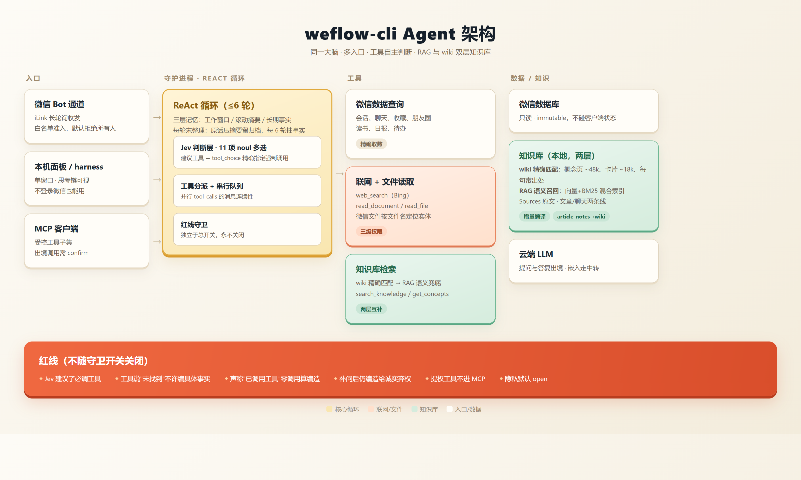

# weflow-cli Agent

> **阶段：初步。** 自建 harness 是一个完整的 harness，轻量化、专为微信适配。设计出发点是持久化独立部署。目前循环、记忆、判断这块仍在打磨，接口与行为可能调整。

这是 weflow-cli 里唯一"会自己决定调什么工具"的部分。README 是门户，本篇收纳它的完整能力、工具清单、权限与可靠性设计；设计取舍的来龙去脉见 [DECISIONS.md](./DECISIONS.md)（按编号查）。

参与改进这个 Agent 时，先读 [AGENT_ITERATIONS.md](./AGENT_ITERATIONS.md)——那里记着每次迭代"试过什么没用、学到什么"，避免重复踩坑。

## 它跑在哪

Agent 是守护进程（`weflow-cli assistant start`）里的一个循环。同一个大脑、同一份三层记忆，可以从三个入口进：

| 入口 | 说明 |
|---|---|
| 微信 Bot 通道 | 官方 iLink 长轮询收发；默认拒绝所有来信，需配白名单 |
| 本机面板 | `weflow-cli panel`，悬浮球小窗，不登录微信也能用 |
| 云手机 harness | 独立浏览器 profile 的单窗口（`?agent=1`），带思考链面板；只连助手、不开会话镜像 |

三个入口共用同一份记忆与每日配额，不会各写一份。

## 一次答复是怎么来的

```
来信 → 判断层 Jev（一次调用问"可能需要哪些工具"，多选）
     → ReAct 循环：模型选工具 → 执行 → 看结果 → 再决定，直到给出不带工具调用的答复
     → 三层记忆落盘（工作窗口 / 滚动摘要 / 长期事实）
```

- **判断层 Jev**：默认开。一次 `decide.py` 调用问 N 个独立 `noul` 问题，把建议作为参考消息注入。判断失败/没建议时静默跳过，不报错、不影响对话。
- **强制调用红线**：Jev 建议了工具、模型却零调用就想作答 → 丢弃答复、注入强约束回炉一次（D-202）。只强制一次，防无限重跑。"调多调少、调对调错"暂不纠缠，先保证"必须查"。
- **工具消息连续性**：同一消息里的多个 `tool_calls` 按 OpenAI 兼容协议连续执行——附加消息（失败提醒、图片）先攒着，等这批 `tool` 消息全部 push 完再追加，否则长链条会触发 400（D-192）。

## 工具清单

工具按"这台机器跑得了什么"动态裁剪——缺依赖的工具不摆进工具表，避免模型去试、拿一串报错回来。

| 类别 | 工具 | 说明 |
|---|---|---|
| 微信数据 | `list_sessions` / `get_messages` / `search_chats` / `search_semantic` | 会话、聊天记录（含时间窗）、跨会话检索、语义检索 |
| 收藏与内容 | `search_favorites` / `read_favorite` / `fetch_article` / `search_public` | 收藏检索与正文、公众号文章抓取、公开文章搜索 |
| 社交与回顾 | `get_sns` / `get_weread` / `get_daily_report` / `get_review` / `get_stats` | 朋友圈、微信读书、日报、学习回顾、统计 |
| 待办与记忆 | `get_todos` / `set_todo_status` / `save_memory` / `search_memory` | 待办读取与状态翻转、长期记忆读写 |
| 知识库 | `search_knowledge` / `get_concepts` / `lint_wiki` / `list_skills` / `read_skill` | 概念页、概念索引、知识库体检、技能包 |
| 协作 | `draft_reply` / `who_owes_reply` / `list_contacts` / `check_skills` | 回复草稿（只产出文本、不发送）、谁在等回话 |
| 联网 | `web_search` | 通用网页搜索（Bing 公开搜索页，免 key） |
| 文件 | `read_file` / `read_document` | 纯文本 / 解析 PDF、Word(.doc/.docx)、Excel(.xls/.xlsx)、PPT(.pptx)、HTML；微信文件可按文件名定位 |
| 权限 | `escalate` | 自主解锁 L1（工作区外只读）；L2 不通过工具开放 |

**MCP 子集**：MCP 的工具面从这张表派生，去掉 `save_memory`、`look_at_image`、`set_todo_status`，以及提权与文件/联网类的 `escalate`、`read_file`、`read_document`、`web_search`。它**不是纯只读**（`export_chat` 会写文件），但发送消息、发布文章、改配置、写助手记忆都没有工具可达。以 `weflow-cli capabilities --json` 的输出为准。

## 知识库：两套检索，相辅相成

知识库有**两层索引，职责不同、互为补充**：

| | wiki 概念页（精确匹配） | RAG 语义索引（语义检索） |
|---|---|---|
| 存什么 | 从文章/对话提炼的**概念页** ~48k，每页有定义、要点、来源链接；卡片 ~18k、Sources 原文两条线 | 聊天 + 文章的**向量 + BM25 混合索引**，按块存原文片段 |
| 怎么查 | `search_knowledge` 先按概念名/正文**精确匹配**；`get_concepts` 看概念邻居 | `search_knowledge` 在概念页没命中时**兜底**到语义索引，按意思找原文 |
| 擅长 | 概念定义、已整理的知识、"这个术语怎么讲"——**精确、可核对**（每句带出处） | "哪篇文章说过 X"、"按意思找相似内容"——**模糊、召回广** |
| 更新 | 增量编译 `article-notes → wiki`（新概念才生成，不重复烧模型） | 增量嵌入新条目（`search-index`，只嵌新 id） |

**调用顺序**：`search_knowledge` 先走 wiki 精确匹配；没命中再 fallback 到 RAG 语义索引（D-206）。这样"Claude Code 是什么概念"给精确定义，"端侧超节点"这种只在文章标题里出现的也能通过语义兜底找到。两者不是替代关系，是**精确 + 召回**的组合。

## 三级文件权限

对齐"默认安全、一级只读、二级人工白名单"的三级定义；这里的"权限"= 开放哪些文件路径：

| 级别 | 语义 | 怎么进 |
|---|---|---|
| **L0 默认** | 包目录、`~/.weflow-cli`、微信数据根（dbPath）、会话 cwd 内读写 | 默认就在 |
| **L1** | 工作区外**只读** | 助手调 `escalate(level=1)` 自主解锁；会话级，重启归零 |
| **L2** | 工作区外写 / 执行命令 | **白名单人工配置，不实现**——助手本就没有写/执行工具 |

- 路径一律 `resolve` + `realpath` 规范化，`..` 逃逸与符号链接都按真实目标判定。
- 工作区外的文件读不了时，助手会先 `escalate` 再读——L1 只读，不会写。
- 微信收到的文件在 `dbPath/<wxid>/msg/file/` 下，`read_document` 传文件名就能定位实体，不用猜路径（D-203）。服务器读老 `.doc/.xls` 依赖 `antiword`/`catdoc`/`xlrd`（系统依赖，换机器需重装）。

## 红线

这几条**独立于守卫总开关**（守卫默认关），是永不关闭的底线：

1. **Jev 建议了就必须调工具**：零工具作答会强制回炉（D-202）。
2. **工具说"未找到"就不许编**：工具原文含明确否定信号，答复却给出 `《标题》`/数字/来源 → 顶回去（D-205）。真实事故：`read_favorite` 返回未找到，模型却编出整篇摘要，下一轮又说没有——前后冲突。
3. **提权工具不进 MCP**：外部机器调用没有"用户口头授权"语义，不能机器自主提权。
4. **不输出内部话术**："被校验拦下 / 内容不可靠 / 不作为后续依据"是记忆写入占位，不是给用户的话（D-196）。

除以上几条，其余守卫（反编造、工具失败提醒等）默认关，可用 `WEFLOW_HARNESS_GUARDS=on` 显式开启。

## 隐私

默认 `assistantPrivacy=open`：聊天正文原样可读、不打码。`balanced`（PII 打码）、`strict`（挡第三方正文）可显式切回；`ollama` 本地引擎完全不出网。仅提问与答复文本发给所配置的 LLM，工具结果里的本机数据按档位决定是否出境。详见 [PRIVACY 相关决策](./DECISIONS.md) 与 [SECURITY.md](../SECURITY.md)。

## 记忆

三层：工作窗口（最近若干轮原话）、滚动摘要、长期事实。事实带来源原话与写入时间，面板「记忆」按钮可查（只读）。模型每轮看到的记忆由 `selectFactsForInjection` 筛选——**测试时注意：反复用同一个问句会把"问句→答复"绑进记忆，污染后续测试**。每版测试前用 `fresh-test.mjs`（在 `_tools/wx-mirror/`）清桶开新会话。

## 架构图



模块与文字以可维护源 [weflow-agent-architecture.html](./images/weflow-agent-architecture.html) 为准（改它后截图生成 PNG，文字 100% 准确）。
